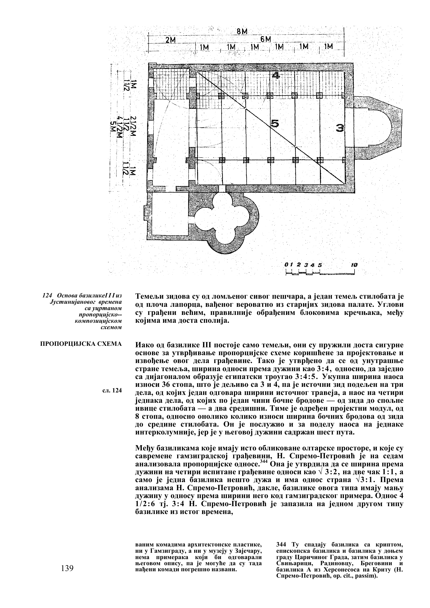
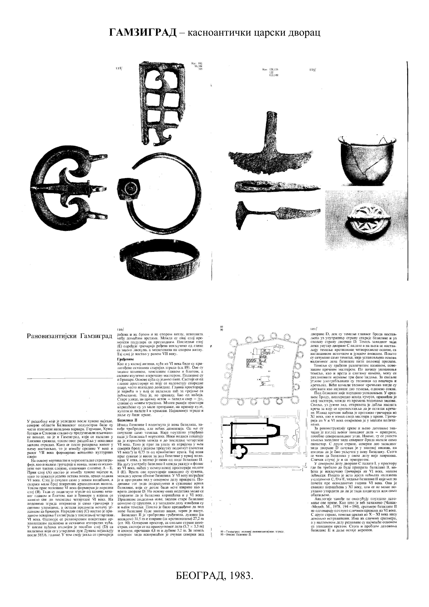
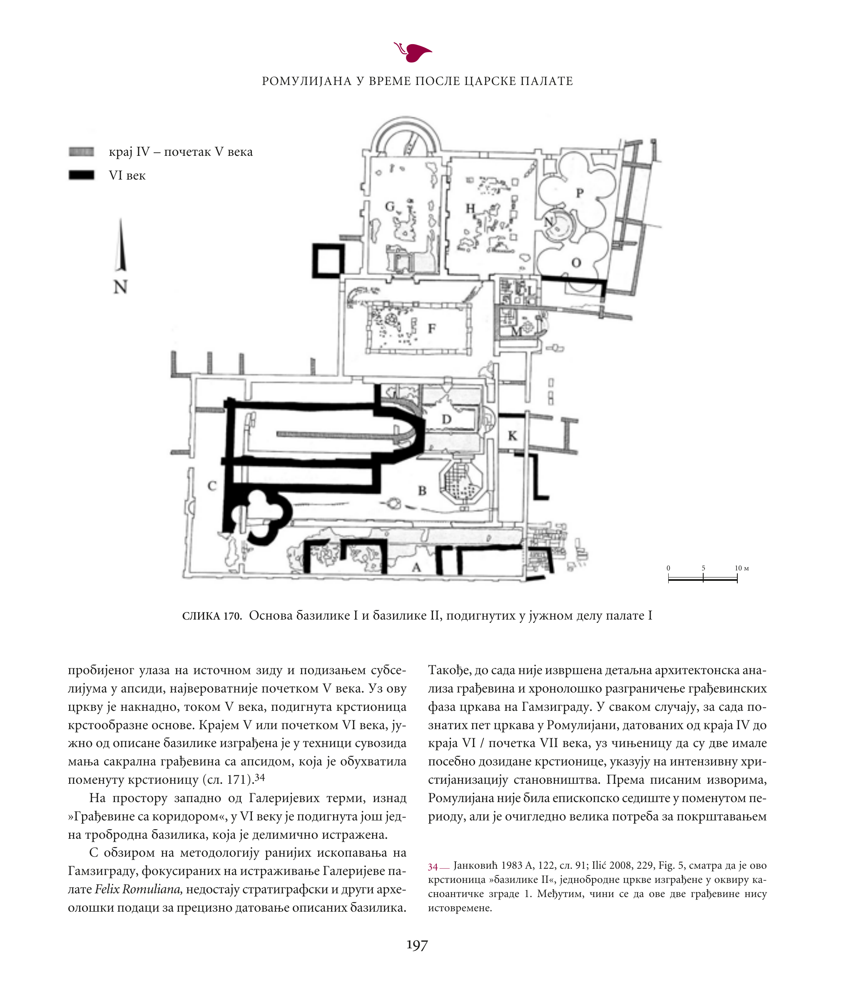

# Romulijana · korelacija bazilike i krstionice

Provera: 31.10.2026 (uključeno u projekat 01.11.2026). Nastavak registra RS-008–012 iz [pregleda slojeva](SLOJEVI.md) i uvod u [proveru podova, keramike i krsta](DATOVANJE-BAZILIKE.md). Vizuelno je pregledano osam renderovanih PDF strana u [`izvori/renderi/planovi/`](../izvori/renderi/planovi/manifest.json).

## Rezultat

Vizuelno poređenje podržava korelaciju **R06 Bazilika III ↔ R05 Bazilika II ↔ R04/Petković Bazilika II**. Ponovljeni sklop je mlađa crkva nad južnim pristupnim dvoranama palate I: izdužena osnova sa oltarskim završetkom na istoku i četvorolisnom krstionicom uz jugozapadni deo. Ovaj identitet nije novo datovanje. Petković i Janković i dalje različito datuju isti sklop u R04.

Korelacija je stručni urednički zaključak iz prikaza i opisa, bez novog terenskog snimanja i bez nezavisnog drugog ocenjivača. Publikacije mogu prenositi istu dokumentaciju; podudarnost nije tri nezavisna arheološka nalaza.

## Stabilni identifikatori za povezivanje

Stabilni ID-jevi su u [`baza/objekti.json`](../baza/objekti.json) i uključeni su u SQLite/FTS indeks tvrdnji (`alati/tvrdnje.js`). Ne zavise od datovanja ili broja bazilike u pojedinačnoj knjizi.

| ID | Objekat | Oznake i izvori | Status korelacije |
|---|---|---|---|
| `ROM-CH-P1-EARLY` | Starija crkva u južnom delu palate I | R06 I; R05 I; R04/Petković I | Tekstualni kontinuitet [RS-007](SLOJEVI.md#rs-007); plan R04 sl.170 prikazuje stariji sloj sivom bojom. Potpun plan R06 I ovim radom nije upoređen. |
| `ROM-CH-P1-LATE` | Mlađa crkva na istom mestu | R06 III, sl.124; R05 II, sl.90; R04/Petković II, sl.170; R04/Janković nova bazilika | Vizuelna korelacija prva tri prikaza podržana; Janković povezan opisom i revizijom u nap.16, ne zasebnim planom u pregledanim stranama. |
| `ROM-BAPT-P1-LATE` | Četvorolisna krstionica uz mlađu crkvu | Prilog uz crkvu na R06 sl.124, R05 sl.90 i R04 sl.170 | Vizuelno povezana; zaseban podobjekat mlađe crkve. Ne poistovećivati sa krstoobraznom krstionicom druge crkve opisane uz R04 sl.171. |

## Šta je stvarno upoređeno

| Osobina | R06 PDF185 / št.139, sl.124 | R05 PDF31 / št.120–121, sl.90 | R04 PDF199 / št.197, sl.170 |
|---|---|---|---|
| Namena crteža | Osnova sa proporcijsko-kompozicijskom shemom; rekonstrukcioni elementi | Sažeta osnova temelja u kontekstu starijih zidova palate | Višefazna osnova palate i crkava sa legendom |
| Oltarski kraj | Unutrašnja polukružna apsida i produžen oltarski prostor; spolja uglast završetak | Istočni završetak zaobljen iznutra, uglast spolja | Isti položaj istočnog završetka nad starijim dvoranama |
| Krstionica | Četvorolisni prilog dole levo, uz zapadni deo južnog boka | Četvorolisni prilog na odgovarajućem mestu | Četvorolisni prilog uz južni bok zapadnog dela; sever označen strelicom |
| Unutrašnje podele | Nizovi kvadrata i projektantski raster | Debele linije podužnih temelja, bez istog rastera stubova | Debeli obrisi mlađeg sklopa naspram sivih starijih zidova |
| Datum na prikazu | Natpis uz sliku pripisuje crkvu Justinijanovom vremenu | Datum se razmatra u tekstu, ostaje otvoren VI ili XI vek | Legenda mlađe zidove označava kao VI vek |

Istočna orijentacija R05/R06 u ovoj tabeli potkrepljena je tekstualnim opisima, a za R04 i strelicom severa. Nije rađena georeferencija niti merenje uglova ili dimenzija iz piksela. Debljina linije, stilobat i rekonstruisani stub nisu međusobno zamenljivi podaci. Spoljašnji završetak R06 opisuje kao trapezast, a R05 i Janković kao petostran: sačuvati formulacije autora, bez izjednačavanja geometrije na osnovu ovog pregleda.

### R06 · osnova sa autorskom shemom

### R05 · plan u donjem delu zbirne PDF strane

### R04 · plan crkava i palate sa autorskom legendom

## Dve ispravke koje vizuelna provera donosi

1. **R06 sl.120 je fotografija temelja**, na [PDF174](../izvori/renderi/planovi/R06-p174.png), a plan korišćen za poređenje je **sl.124 na PDF185**. Upućivanje teksta R06 PDF184 na sl.120 ne vodi na plan.
2. **R06 sl.124 uključuje autorsku rekonstrukcionu shemu.** Raster, proporcijski trougao i raspored stubova ne prenose se kao neposredno zatečeni nalazi. R05 PDF31 izričito navodi da su sačuvani temelji, bez utvrđene osnove nadzemnog dela ili položaja prolaza.

[R06 PDF179](../izvori/renderi/planovi/R06-p179.png), sl.122, sadrži samo deo velikog plana starije bazilike; dostupan prikaz je odsečen. Nije korišćen za potpunu korelaciju starije crkve niti za zaključak o odsustvu zidova u odsečenom delu.

## Datovanje ostaje otvoreno

- **R06, Čanak-Medić 1978:** VI vek, Justinijan; [PDF184 / št.138](../izvori/renderi/planovi/R06-p184.png). Oblik i stratigrafija su argumenti autorke, ne samostalni kalendarski datum slike. Neutvrđen nivo poda i moguća nedovršenost ostaju ograničenja.
- **R05, 1983:** gradnja ne pre osamdesetih godina VI veka; upotreba u XI; nije razrešeno da li je tada građena ili obnavljana. [PDF31 / št.120–121](../izvori/renderi/planovi/R05-p031.png). Autor odeljka ovim radom nije potvrđen iz potpisa.
- **R04, Petković 2010:** VI vek, verovatno Justinijan; plan na sl.170 vizuelno prenosi tu atribuciju kroz legendu. Ona je autorska interpretacija, ne dodatni dokaz nezavisan od poglavlja.
- **R04, Janković 2010:** novu baziliku razmatra kao srednjovekovnu i u nap.16 izričito revidira svoju atribuciju iz 1983. [PDF207 / št.205](../izvori/renderi/planovi/R04-p207.png). U pregledanim PDF207–208 nema nove osnove koja bi geometrijski razrešila spor.

[Litijski krst, R04 PDF208 / št.206, sl.177](../izvori/renderi/planovi/R04-p208.png), vizuelno je proveren zajedno sa potpisom koji ga datuje u XI vek. To potvrđuje šta publikacija prikazuje i kako ga autor datuje. Fotografija sama ne potvrđuje datum gradnje bazilike, kontekst nalaza ili tipološko datovanje; kataloški zapis i kontekst provereni su u [DATOVANJE-BAZILIKE.md](DATOVANJE-BAZILIKE.md).

## Dokaz, provera i nastavak

[Manifest](../izvori/renderi/planovi/manifest.json) čuva SHA-256 tri izvorna PDF-a i osam renderovanih strana, brojeve PDF strana i veličine slika. Snimci su cele PDF strane; R05 jedna PDF strana sadrži više štampanih strana, pa nije korišćen automatski pomeraj numeracije. Mašinska provera: [`baza/provere/provera-planovi.json`](../baza/provere/provera-planovi.json).

Nastavak ove provere izveden je u [DATOVANJE-BAZILIKE.md](DATOVANJE-BAZILIKE.md) (tvrdnje RD-001–008) i uključen u SQLite/FTS pretragu (`node alati/trazi.js --tvrdnje ROM-CH-P1-LATE`).
